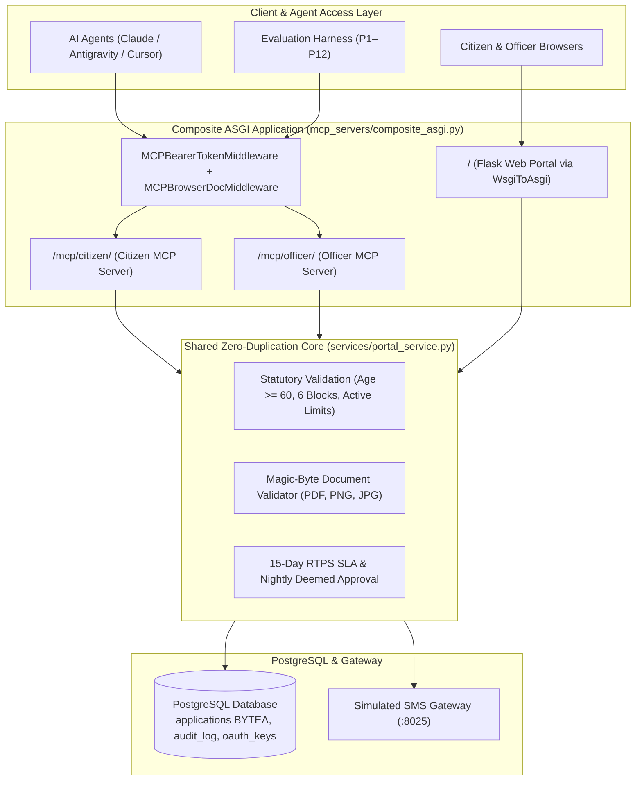

# Sewa Setu — AI-Assistant & Old Age Pension Portal

> Modernized with an authoritative Model Context Protocol (MCP) AI-agent layer, strict OAuth 2.1 RBAC authorization, in-database document persistence, real-session persona evaluations, and an interactive `/eval-dashboard`.

---

## 🏛️ Project Overview

**Sewa Setu** is the public portal for the **Purvanchal Old Age Pension Scheme**, providing a monthly statutory pension of **₹250** to eligible senior citizens aged **60 years and above** across 6 approved administrative blocks.

This repository modernizes the portal with an **enterprise AI assistant layer**:
1. **Independent Citizen & Officer MCP Servers:** Exposes two separate **Streamable-HTTP Model Context Protocol** servers conforming to MCP SDK v2024-11-05.
2. **Strict OAuth 2.1 & RFC 8707 Authorization:** Enforces cryptographic RS256 token verification, canonical resource audiences, and strict Role-Based Access Control (RBAC).
3. **Pure In-Database Document Storage:** Scanned age-proof documents are validated via magic bytes and stored directly in PostgreSQL `BYTEA` (`applications.doc_data`). Zero files are stored on disk.
4. **Synthetic Evaluation Harness & Live Dashboard:** Built-in test runner executing 12 realistic client scenarios (P1–P12) with 100% pass rate rendered at `/eval-dashboard`.
5. **Single-Container Deployment:** Unified ASGI router (`mcp_servers.composite_asgi`) mounting both MCP servers and the Flask WSGI portal under Uvicorn, with background RTPS deemed-approval cron execution.

---

## 📐 System Architecture



---

## ⚡ Quick Start

### 1. Run Locally with Docker Compose

Ensure Docker is running, then run:

```bash
docker compose up --build -d
```

All 4 services will build and start:
- **Web & MCP Portal:** `http://localhost:8000`
- **Postgres Database:** `localhost:5432` (pre-seeded with schema)
- **Nightly SLA Scheduler:** Runs `deemed_approval.py` via background cron
- **Simulated SMS Gateway:** Internal network (`http://smsgw:8025`), accessible via web at `/__gateway/`

### 2. Verify MCP Endpoints & Diagnostics

Run the automated diagnostic check:

```bash
python3 app/scripts/check_mcp.py http://localhost:8000
```

To test against your live deployed server on Render:

```bash
python3 app/scripts/check_mcp.py https://<your-render-app>.onrender.com
```

### 3. Run the Automated Unit Test Suite

```bash
python3 -m unittest discover tests
```
> **Test Status:** 50/50 unit tests passing (100% pass rate in ~1.6s).

---

## 🌐 Endpoints & URLs

| Route | Description | Access / Auth |
| :--- | :--- | :--- |
| `/` | Citizen portal homepage with live scheme guidelines | Public |
| `/status` | Citizen tracking login (Mobile + DOB as password) | Citizen OTP / Session |
| `/admin` | Departmental officer review queue and dashboard | Officer credentials (`admin` / `ADMIN_PASSWORD`) |
| `/eval-dashboard` | Real-session persona evaluation & security dashboard | Public / Evaluator |
| `/__gateway/` | Simulated SMS gateway inbox & OTP console | Public (Development) |
| `/mcp/citizen/` | Citizen Model Context Protocol streamable-HTTP server | OAuth 2.1 (Audience: `.../mcp/citizen`) |
| `/mcp/officer/` | Officer Model Context Protocol streamable-HTTP server | OAuth 2.1 (Audience: `.../mcp/officer`) |
| `/.well-known/jwks.json` | Public RSA JSON Web Key Set for JWT verification | Public |
| `/.well-known/oauth-authorization-server` | RFC 8414 OAuth 2.1 Authorization Server metadata | Public |

---

## 🛠️ Model Context Protocol (MCP) Tool Specifications

### Citizen MCP Server (`/mcp/citizen/`)
*Strictly scoped to applicant capabilities. Derived ownership prevents querying or mutating other citizens' records.*

| Tool Name | Type | Description | Required Parameters |
| :--- | :--- | :--- | :--- |
| `citizen_health` | Read | Readiness probe returning scheme information and server status. | None |
| `get_scheme_requirements` | Read | Authoritative scheme rules: ₹250/month benefit, 60+ age rule, 6 approved blocks (`Sonari`, `Rajapara`, `Dhemaji Pathar`, `Borgaon`, `Namti`, `Khelua`), and 15-day SLA policy. | None |
| `check_my_application_status` | Read | Checks current status (`PENDING`, `APPROVED`, `REJECTED`, `DEEMED_APPROVED`, `WITHDRAWN`). In case of rejection, retrieves officer's justification from `audit_log`. Bank numbers are strictly redacted. | `auth_token` |
| `check_application_requirements` | Read | Pre-submission validation testing draft details against statutory rules without persisting to database. | Draft fields (`applicant_name`, `dob`, `block`, etc.) |
| `submit_pension_application` | Mutation | Submits new application. Validates magic bytes (`%PDF-`, `PNG`, `JPEG`), checks active application limits, and persists directly into PostgreSQL `BYTEA`. | Draft fields + `document_base64` |
| `withdraw_my_pending_application` | Mutation | Withdraws a `PENDING` application under statutory rights, freeing the citizen to re-apply afresh. | `auth_token` |
| `citizen_auth_test` | Diagnostic | Validates caller's Bearer JWT and echoes authenticated citizen mobile. | `auth_token` |

---

### Officer MCP Server (`/mcp/officer/`)
*Strictly scoped to departmental review. Enforces mandatory justification for rejections and masks sensitive financial data.*

| Tool Name | Type | Description | Required Parameters |
| :--- | :--- | :--- | :--- |
| `officer_health` | Read | Officer server health diagnostic and jurisdiction confirmation. | None |
| `list_pending_applications` | Read | FIFO review queue of pending applications with SLA warning flags for applications approaching 15 days. | `auth_token` |
| `get_application_for_review` | Read | Complete case dossier including applicant info, age calculation, doc verification status, and masked bank account (`********1234`). | `application_id` (or `application_no`), `auth_token` |
| `record_application_decision` | Mutation | Officially approves (`APPROVED`) or rejects (`REJECTED`) an application. **Rejections require a non-empty statutory justification note** recorded in `audit_log`. | `application_id`, `decision`, `note` (mandatory if REJECTED), `auth_token` |
| `officer_auth_test` | Diagnostic | Validates officer Bearer JWT and echoes authenticated username. | `auth_token` |

---

## 🔒 Security & Authorization Architecture

### 1. OAuth 2.1 & RFC 8707 Resource Indicators
Tokens are digitally signed using RSA RS256 with key rotation stored in PostgreSQL `oauth_keys`. Every request to the MCP endpoints is validated against:
- **Canonical Audience:** 
  - Token for `/mcp/citizen/` MUST have `aud: <BASE_URL>/mcp/citizen`.
  - Token for `/mcp/officer/` MUST have `aud: <BASE_URL>/mcp/officer`.
  - A token minted for the Citizen MCP server is rejected by the Officer server with `403 Forbidden`.
- **Role & Scope Enforcement:** Tokens must possess `role: citizen` and `scope: citizen` (or `officer`).
- **Subject-Bound Identity:** Citizen identity is extracted strictly from `sub: citizen:<mobile>`. Citizens cannot inspect or tamper with any application belonging to another mobile number (zero IDOR vulnerability).

### 2. Pure Database Document Persistence (Zero Disk Leakage)
In compliance with ephemeral cloud environments (like Render) and data privacy standards:
- Uploaded PDF, PNG, and JPG documents are checked in memory for genuine magic bytes:
  - PDF: `%PDF-`
  - PNG: `\x89PNG\r\n\x1a\n`
  - JPEG: `\xff\xd8`
- Web uploads use PostgreSQL `pending_uploads (mobile, doc_data BYTEA, doc_mime, doc_name)`.
- Upon final declaration or MCP submission, files are stored permanently into `applications.doc_data` (`BYTEA`), and `doc_path` is cleared to `""`.
- The `uploads/` filesystem directory is never used for permanent file retention.

### 3. Generating Tokens for Manual Testing
You can generate valid 30-day testing tokens using the helper script:

```bash
# Mint Citizen Token (for mobile 9905041855):
python3 app/scripts/mint_token.py citizen 9905041855

# Mint Officer Token (for admin):
python3 app/scripts/mint_token.py officer admin
```

---

## 📊 Persona Evaluation Harness (`/eval-dashboard`)

The system includes an automated evaluation harness ([`app/services/eval_runner.py`](file:///Users/asur/Downloads/sewasetu-ai-handout/app/services/eval_runner.py)) simulating real client conversations across **12 distinct personas (P1–P12)** over live streamable-HTTP sessions.

| ID | Persona & Intent | Target | Role | Key Verification & Evidence |
| :--- | :--- | :--- | :--- | :--- |
| **P1** | Kamla Devi (Age 68) — Eligible fresh submission | `/mcp/citizen` | Citizen | Age 68 >= 60; application persisted with status `PENDING` and audit log entry. |
| **P2** | Ramesh (Age 59) — Underage validation | `/mcp/citizen` | Citizen | Rejected with statutory explanation; zero records inserted into database. |
| **P3** | Sita Devi (Age 72) — Unapproved block rejection | `/mcp/citizen` | Citizen | Block 'Dispur' denied against 6 approved blocks; clear guidance returned. |
| **P4** | Mohan Lal (Age 70) — Withdrawal & reapplication | `/mcp/citizen` | Citizen | Existing pending application withdrawn; freed to re-apply afresh. |
| **P5** | Phoolmati Devi (Age 75) — Data minimization check | `/mcp/citizen` | Citizen | Status retrieved; bank account and document bytes strictly excluded from payload. |
| **P6** | Cross-Citizen Inspection — IDOR protection | `/mcp/citizen` | Citizen | Attempt to query another citizen's application fails with neutral `not_found`. |
| **P7** | Welfare Officer — FIFO queue & dossier | `/mcp/officer` | Officer | FIFO queue retrieved with SLA warnings; dossier masks bank account (`********5566`). |
| **P8** | Departmental Officer — Mandatory rejection reason | `/mcp/officer` | Officer | Rejection requires justification; audit entry created with officer signature. |
| **P9** | Departmental Officer — Verified approval | `/mcp/officer` | Officer | Case approved; status transitioned to `APPROVED` with audit record. |
| **P10** | Privilege Escalation — Citizen calls officer tool | `/mcp/officer` | Citizen | Blocked with 403 Forbidden due to role mismatch; zero queue data disclosed. |
| **P11** | Public Kiosk User — Session expiration | `/mcp/citizen` | Citizen | Expired token rejected with 401 Unauthorized; prompt renewal requested. |
| **P12** | Anil Bordoloi — Duplicate submission idempotency | `/mcp/citizen` | Citizen | Re-submission of active application rejected with `DUPLICATE_ACTIVE_APPLICATION`. |

### Accessing the Live Dashboard
Navigate to **`/eval-dashboard`** in your browser to view:
- Global pass rate metrics (**12 / 12 Passing — 100.0%**).
- Status & category filter tabs (Eligibility, Lifecycle, Security/RBAC).
- Full sanitized JSON-RPC transcripts and request/response payloads.
- Architectural insights and evaluation evidence.

---

## 💻 Connecting AI Clients (Claude Desktop, Cursor, Antigravity)

### Claude Desktop Integration
Add the following to your `claude_desktop_config.json`:

```json
{
  "mcpServers": {
    "sewasetu-citizen": {
      "url": "https://<your-app>.onrender.com/mcp/citizen/"
    },
    "sewasetu-officer": {
      "url": "https://<your-app>.onrender.com/mcp/officer/"
    }
  }
}
```

### Antigravity IDE Integration
Add to `~/.gemini/config/mcp_config.json`:

```json
{
  "mcpServers": {
    "sewasetu-citizen": {
      "url": "https://<your-app>.onrender.com/mcp/citizen/"
    },
    "sewasetu-officer": {
      "url": "https://<your-app>.onrender.com/mcp/officer/"
    }
  }
}
```

---

## 📂 Repository Layout

```text
sewasetu-ai-handout/
├── app/
│   ├── app.py                      # Core Flask web portal & database access
│   ├── oauth.py                    # OAuth 2.1 authorization server & JWT signing
│   ├── schema.sql                  # PostgreSQL database DDL (including BYTEA storage)
│   ├── Dockerfile                  # Production container definition (uvicorn + cron)
│   ├── requirements.txt            # Python dependencies (mcp, pyjwt, starlette, etc.)
│   ├── eval_results.json           # Pre-baked 12-persona evaluation evidence
│   ├── mcp_servers/
│   │   ├── citizen_server.py       # Citizen Streamable-HTTP MCP server & tools
│   │   ├── officer_server.py       # Officer Streamable-HTTP MCP server & tools
│   │   ├── composite_asgi.py       # Unified ASGI router & browser doc middleware
│   │   └── auth.py                 # OAuth 2.1 token verification & RBAC middleware
│   ├── services/
│   │   ├── portal_service.py       # Shared statutory logic (zero-duplication service)
│   │   └── eval_runner.py          # Real-session synthetic evaluation harness
│   ├── scripts/
│   │   ├── check_mcp.py            # Streamable-HTTP MCP diagnostic utility
│   │   ├── mint_token.py           # Testing token generator CLI
│   │   └── deemed_approval.py      # Nightly 15-day statutory SLA cron script
│   └── templates/
│       ├── eval_dashboard.html     # Interactive evaluation dashboard UI
│       ├── admin_list.html         # Officer review queue template
│       └── ...                     # Citizen registration & status portal templates
├── seed/
│   └── seed.sql                    # Production data baseline snapshot (~100k records)
├── smsgw/                          # Simulated telecom SMS gateway service
├── tests/                          # Automated unit & integration test suite (50 tests)
├── docker-compose.yml              # Multi-container local orchestration
├── render.yaml                     # Cloud deployment blueprint
└── README.md                       # Main repository readme
```

---

## 📜 Statutory Rules Summary

1. **Eligibility:** Minimum 60 years of age on application date (calculated in Indian Standard Time).
2. **Approved Blocks:** `Sonari`, `Rajapara`, `Dhemaji Pathar`, `Borgaon`, `Namti`, `Khelua`.
3. **Application Limit:** At most one active application (`PENDING`, `APPROVED`, or `DEEMED_APPROVED`) per mobile number.
4. **Statutory SLA:** Purvanchal RTPS Act mandates a **15 calendar day SLA**. Any application pending beyond 15 days is automatically marked `DEEMED_APPROVED` by the nightly batch job.
5. **Decisions:** Rejections require an official statutory justification note recorded in `audit_log`. Approvals generate status portal accounts for pension tracking.
